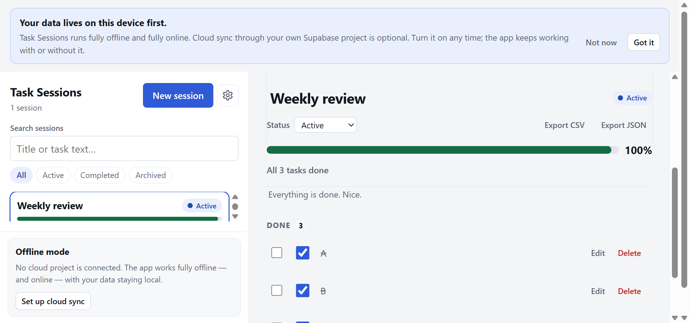

# Task Sessions

A local-first desktop app: create chat-like **sessions**, add **tasks** inside them, and watch a
progress bar update the instant you tick a task off. Everything lives in a local SQLite file — no
account, no network, no cloud.

v1 was fully offline. **v2 adds optional cloud sync** through your own Supabase project, so the
same sessions can be opened on another device.

Built from `PLAN.md` (v1, desktop). Stack: Electron + React 18 + TypeScript + Vite, with SQLite via
the runtime's built-in `node:sqlite` (no native modules to compile).



**Keywords:** local-first task manager, offline todo app, desktop task tracker, Electron React app,
TypeScript productivity app, SQLite task manager, Supabase sync, real-time progress tracker,
accessible keyboard-friendly todo list.

---

## What works

- **Sessions** — create, inline rename, status (Active / Completed / Archived), archive, soft delete, restore.
- **Tasks** — add (Enter to submit), edit, delete, mark done, optional due date, stable ordering, multi-select + bulk delete.
- **Real-time progress** — optimistic React Query update, measured **~12–20 ms** from click to bar movement.
  Screen readers get a polite live region that only speaks when the percentage changes.
- **Accessibility** — native `<progress>` / `<input type="checkbox">`, `aria-live="polite"` progress announcements
  throttled to percentage changes, native `<dialog>` focus trapping, 44×44 hit targets, status never colour-only,
  reduced-motion support, full keyboard flow.
- **Search & filters** — session search across titles and task text, status chips, overdue/today/next-7-days task filters, 300 ms debounce.
- **Export** — CSV and JSON through the native save dialog, filenames `{slug}_{YYYY-MM-DD}.{ext}`.
- **Persistence** — local SQLite (`node:sqlite`) with `PRAGMA user_version` migrations, WAL mode, soft deletes,
  UUID v4 keys, ISO-8601 UTC timestamps.
- **Cloud sync (v2, optional)** — Supabase last-write-wins sync, soft-delete tombstones, dirty flags, token
  storage via `safeStorage`, background auto-sync (60 s interval + 1.5 s debounce after writes). Offline-first:
  no network means no sync, never a forced one.
- **Keyboard** — `Ctrl/Cmd+N` new session, `Ctrl/Cmd+K` focus search, `Enter` on a task opens the editor.
- **Settings** — gear icon in the session list header opens a general settings dialog: Theme (System /
  Light / Dark) and Reduce motion. Preferences are stored locally and applied instantly.

## Prerequisites

- Node.js 22 or newer (developed on 26.4) and npm 10+.
- Windows, macOS or Linux. No Rust, no Visual Studio build tools, no Python needed.

## Commands

> Windows PowerShell note: if `npm` is blocked by the execution policy (`npm.ps1 cannot be loaded`), use
> `npm.cmd` instead, e.g. `npm.cmd run dev`.

| Command               | What it does                                                                                                 |
| --------------------- | ------------------------------------------------------------------------------------------------------------ |
| `npm run dev`         | Vite dev server + Electron window, main-process rebuild included                                             |
| `npm run build`       | Bundles `electron/` → `dist/*.cjs` and the renderer → `dist/renderer`                                        |
| `npm start`           | Runs the built app (`npm run build` first)                                                                   |
| `npm test`            | Vitest: domain logic, repositories against real in-memory SQLite, export builders, sync engine (fake remote) |
| `npm run smoke`       | Builds, then drives the real app with Playwright (26 checks, PLAN.md §7)                                     |
| `npm run typecheck`   | `tsc --noEmit` for the renderer and the main process                                                         |
| `npm run lint`        | ESLint (flat config, TypeScript strict)                                                                      |
| `npm run format`      | Prettier                                                                                                     |
| `npm run package:win` | electron-builder installer into `release/`                                                                   |

`npm run dev` note: the main process is bundled once at start. After editing files under `electron/`, restart
the command (renderer edits hot-reload).

## Where the data lives

`app.getPath('userData')/task-sessions.db`:

- Windows: `%APPDATA%\task-sessions\task-sessions.db`
- macOS: `~/Library/Application Support/task-sessions/task-sessions.db`
- Linux: `~/.config/task-sessions/task-sessions.db`

The database is created and migrated on first launch (`PRAGMA user_version`). Back it up by copying the file
while the app is closed.

## Project layout

```
electron/
  main.ts              window, single-instance lock, DB + sync lifecycle
  preload.ts           contextBridge surface (window.taskSessions)
  ipc.ts               validated IPC boundary + export wiring
  export.ts            CSV / JSON / filename builders (unit tested)
  db/
    connection.ts      open + PRAGMAs + migrations (schema verbatim from PLAN.md §3, v2 adds sync columns)
    sessions.ts        session repository
    tasks.ts           task repository
    syncRepo.ts        sync-specific reads/writes (dirty flags, tombstones, adoption)
  sync/
    engine.ts          adopt -> pull -> merge -> push -> mark clean
    merge.ts           last-write-wins decision
    remote.ts          Supabase-backed RemoteStore behind an interface
    manager.ts         auth + status + background scheduling
src/
  domain/              pure logic: progress, filters, time formatting (+ tests)
  db/                  renderer-side repositories and React Query hooks
  features/sessions/   list, rows, filters, new-session dialog
  features/session-detail/  header, progress, composer, task rows, edit dialog
  features/sync/       sync panel + optional setup dialog + onboarding banner
  components/          Button, ProgressBar, Dialog, ConfirmDialog, StatusChip, EmptyState, ...
  a11y/                keyboard shortcuts
scripts/               dev launcher, main-process bundler, Playwright smoke test
```

## Rules this code follows (from PLAN.md)

- SQLite is the source of truth; the renderer never touches the filesystem.
- IDs are client-generated UUID v4; timestamps are ISO-8601 UTC with milliseconds.
- Soft delete only. Deleted sessions are hidden from All/Active/Completed and recoverable from Archived
  (the single read path that intentionally includes `deleted_at IS NOT NULL`).
- A session never auto-completes: status changes only on explicit user action.
- Progress: `Math.round(done / total * 100)`, soft-deleted tasks excluded, label
  `"All N tasks done"` / `"N of M tasks done"` / `"No tasks yet"`.

## Known limitations

- Single user per machine profile; cloud sync is per Supabase user.
- Last write wins by `updated_at`; no realtime push yet (pull-based).
- No task-level undo/restore UI, no FTS5 search, no drag-and-drop reordering, no installer run yet.
- Tauri was the original plan; the Electron fallback was used because the machine had no Rust or MSVC
  toolchain. The `src/` app is portable: only `src/db/client.ts` and the preload bridge talk to the shell.

## Cloud sync (v2)

Optional. Turn it on from the sidebar sync panel or with `SUPABASE_SETUP.md`. The app stays fully
usable offline; sync only runs when signed in and connected.

## Tests

```bash
npm test      # 68 unit/integration tests
npm run smoke # 20 end-to-end checks against the real Electron app
```

The smoke test runs against a throwaway user-data directory, so your real sessions are untouched. It
writes a screenshot to `docs/app.png`.
